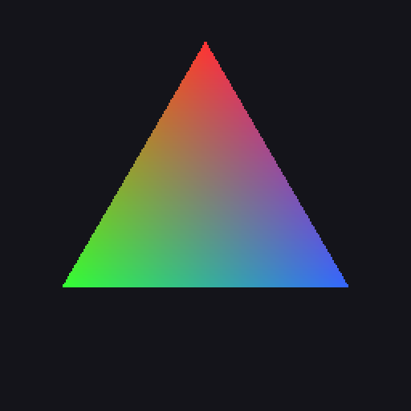

# Graphics

Module `DynamicGraphics`: a surface to draw on with OpenGL ES 2.0, and the
raw input a game needs. It re-exports `CGLES2`, the GL functions and
constants (`gles2.h`). The design is §8 of `DynamicRuntime.md`.

| Contract | Kind | iOS | Android | Linux | Browser |
|---|---|---|---|---|---|
| `Surface` | contract, `requires: "graphics"` | a `CAEAGLLayer` or ANGLE view, `CADisplayLink` | `GLSurfaceView` / EGL, `Choreographer` | EGL window (Mesa), the compositor's frame callback | a WebGL 1 canvas, `requestAnimationFrame` |
| `SurfaceDelegate` | callback | touches, `UIKey` | `MotionEvent`, `KeyEvent` | SDL3 or Wayland events | pointer and keyboard events |

No host implements them yet. The guest side, the GL import shim for wasm
hosts, and an example (`examples/ExampleGL`) exist, and the example draws
on a real GL under a test host:



Guest-side Swift: `PointerKind`, `PointerPhase`, `PointerButtons`,
`KeyModifiers`, `KeyCode`, the `PointerEvent`, `KeyEvent` and `SurfaceFrame`
structs, and `SurfaceEvents`, a delegate that calls closures and keeps the
input state.

The SwiftUI frontend has the view: `GLSurface(_ surface: Int32)`.

## For a guest

```swift
import DynamicGraphics
import SwiftUI

let events = SurfaceEvents()
events.onFrame = { frame in
    glViewport(0, 0, frame.width, frame.height)
    glClearColor(0, 0, 0, 1)
    glClear(GL_COLOR_BUFFER_BIT)
    if events.isPressed(.space) { jump() }
}
let surface = SurfaceProxy.make(events)

// In a view's body:
GLSurface(surface.identifier())
    .frame(height: 280)
```

- **The host owns the window and the GL context.** There's no window API.
  A surface is a view: `GLSurface` places it, and SwiftUI lays it out,
  layers it and clips it like any other.
- **GL is callable only inside `frame`.** That's the only time the context
  is current. Make shaders and buffers in the first frame.
- **After `contextLost`, every GL object is gone.** Make them again in the
  next frame, as in WebGL.
- **No frames or input without a view.** A surface that isn't on screen,
  or an app that isn't active, gets neither.
- The manifest declares `.graphics(.gles2)`.

### GL under WebGL 1 rules

The functions are GLES 2.0's without `glShaderBinary` and
`glReleaseShaderCompiler`: 140 of them. The same code runs in every mode,
so it follows the strictest one:

- **Vertex data comes from buffers.** `glVertexAttribPointer`'s and
  `glDrawElements`' last argument is an offset into the bound buffer
  (`nil`, or `UnsafeRawPointer(bitPattern: offset)`), never a pointer to
  an array.
- There's no `glMapBuffer`.
- Shaders are GLSL ES 1.00, and fragment shaders state their precision.
- Ask `glGetString(GL_EXTENSIONS)` before using an extension.
- Constants are typed (`GL_TRIANGLES` is a `GLenum`), so Swift needs no
  casts for most calls. `glTexParameteri`'s value is a `GLint`:
  `GLint(GL_LINEAR)`.

### Input

Pointers, keys and focus arrive on the delegate between frames; §8.6 has
the rules. In short:

- Positions are pixels of the drawable, from the top left: the pixels
  `glViewport` takes.
- A `KeyCode` names a physical key (a USB HID usage ID), not a character.
  `.w` is the key above `.s` on every layout.
- Moves are coalesced to one per pointer per frame.
- After `focus(false)`, every key counts as released. `SurfaceEvents`
  does that for you.

## For a host

A host implements `Surface` like any contract, gives the guest GL, and
drives the delegate.

### The surface

1. `make(_:)`: keep the delegate; create nothing visible yet.
2. When a `GLSurface` node appears whose `surface` prop equals a surface's
   `identifier()`, put the GL view there and create the context.
3. Call `resize` with the drawable's pixel size and scale before the first
   frame and whenever they change.
4. Each display refresh, while the node is on screen and the app is active:
   make the context current, call `frame`, present, and clear the current
   context.
5. Deliver input on the main thread, between frames (§8.6): hit testing
   first (views over the surface take their pointers), one `move` per
   pointer per frame, `cancel` then `focus(false)` when focus is lost.
6. If the context is lost: `contextLost`, then, with a new context,
   `contextRestored`.

### Giving the guest GL

| The guest is | The host |
|---|---|
| a native slice | links a GLES 2.0 library (libGLESv2, OpenGLES.framework, ANGLE). The slice calls `gl*` directly. |
| `App.wasm` under WasmKit | passes `WasmApp` a `WasmGL`, made from a function that looks GL symbols up by name (`dlsym`, `eglGetProcAddress`). Calls `WasmGL.contextLost()` when a context is lost. |
| `App.wasm` through wasm2c | links a GLES 2.0 library as for a native slice, and defines `rt_gl_context_generation` (below). `wasm2c-shim.py` adds the GL imports when the module uses them. |

A wasm guest's GL calls go through the shim in `CRuntimeGL`, generated by
`Scripts/gles2.py` with `gles2.h`:

- **Pointers are bounds-checked** against the guest's memory, for as many
  bytes as GL reads or writes. A bad one traps the guest; GL isn't called.
- **Buffers are required** where GL would otherwise take a host address:
  `glVertexAttribPointer` without an `ARRAY_BUFFER`, `glDrawElements`
  without an `ELEMENT_ARRAY_BUFFER`, and any draw with an enabled
  attribute that has no buffer, fail with `GL_INVALID_OPERATION`.
- **Not checked:** a draw's indices and counts against the buffers' sizes.
  That's the GL implementation's to make safe. Use ANGLE's WebGL
  compatibility context where it must be guaranteed.

The shim tracks which buffers are bound. A new GL context has none of
them, so the shim has to hear of it:

```c
/* A number that changes whenever the context the guest draws in is a new
 * one. A host whose context is never replaced returns a constant. */
uint32_t rt_gl_context_generation(void);
```

A wasm2c slice calls it on every GL call, so it should only read a
variable. The WasmKit path uses `WasmGL.contextLost()` instead.

**Capability.** `WasmApp` binds the `env.gl` imports only when the app's
capabilities include `graphics`; a module that imports GL without it
doesn't load. `Surface` requires the capability too, so the packager
rejects such an app first.

## Threading

Every delegate method runs on the main thread (§6.4), and so does every GL
call, since the guest only runs there.

## Example

`examples/ExampleGL`: a triangle whose spin a tap reverses and Space
pauses, with SwiftUI controls around the surface.
Tests run it against a GL that records its calls, in all three forms:
`App.wasm` under WasmKit (`Packages/RuntimeWasm`), and a sealed native
slice and wasm2c output (`Packages/LinkedSlice`).

`Scripts/test-gl-mesa.sh` draws it on a real GL: Mesa's software renderer
in Docker, with an EGL pbuffer and a C host of about 200 lines
(`Scripts/hosts/gl-mesa-host.c`), which is also the shortest example of
what a host does for a surface. It runs the Linux slice and the wasm2c
build, checks pixels before and after half a turn and after the context is
replaced, and compares the two builds' frames, which are identical. No
window, input or display is involved.
